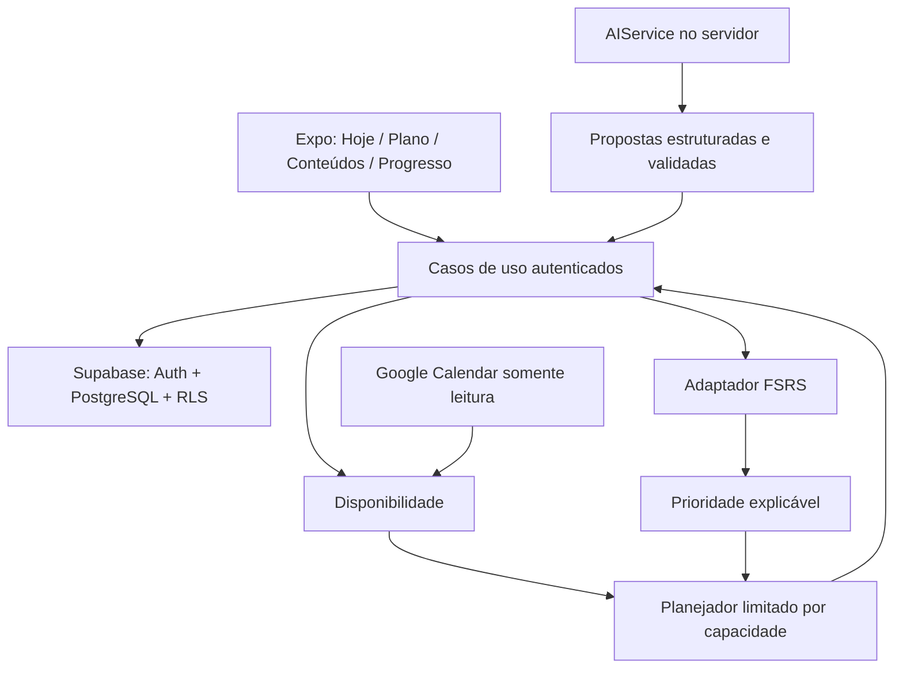

# Studygram — arquitetura e contrato do produto

> Atualização: por decisão do usuário, o primeiro cliente é web (React + Vite), publicado no repositório `gabrielfporto/studygram_` pelo GitHub Pages. O núcleo permanece reutilizável. Auth, catálogo, rotina, registro transacional e a primeira interface estão implementados; consulte `deployment.md` para o estado operacional. As seções abaixo preservam a especificação completa, incluindo funções futuras.

## 1. Escopo e decisões

Primeira entrega: especificação, modelo relacional, núcleo executável, testes e simulação. Nenhuma tela antes da validação do motor. Expo/React Native + TypeScript será o cliente mobile; os mesmos módulos puros poderão atender web. Supabase Auth + PostgreSQL será a persistência. Sem microserviços, pagamentos ou chatbot separado.

O domínio não importa React, Expo, Supabase ou OpenAI. Recebe dados validados e um relógio explícito. Devolve plano, decisões e motivos. Repetir entradas, versão e parâmetros deve produzir a mesma saída. O histórico real nunca é substituído por um plano recalculado.

Limites: memória estima quando recuperar; prioridade avalia relevância; planejador escolhe atividades viáveis. IA auxilia entrada e conteúdo, sem decidir o plano. Não há chamadas de IA no núcleo.

## 2. Fluxo do usuário

Entrar → objetivo → conteúdos → contexto atual/próximo → disponibilidade semanal → calendário opcional → revisar conteúdos → primeiro plano. Cada etapa deve permitir continuar com configuração mínima. Calendário e IA não são pré-requisitos.

Hoje → ver próxima atividade e motivo → iniciar → recuperação/estudo externo → concluir ou registrar parcial → informar questões e feedback simples → persistir sessão → atualizar evidência e memória somente se houve recuperação → recalcular tempo restante.

Uma sessão não realizada não modifica FSRS. Leitura passiva conta como tempo/exposição, mas não prova retenção. Sessão parcial usa tempo real; só atualiza memória se houve tentativa de recuperação. Erros detalhados são associados a competências; ambiguidade gera proposta para confirmação.

## 3. Modelo relacional

Todas as entidades pertencem a `user_id`. Chaves compostas `(user_id, id)` e FKs compostas impedem vincular dados de outra pessoa, mesmo quando a linha filha pertence ao usuário correto. IDs são UUID. Datas de eventos são `timestamptz`; dias de plano são `date` no fuso do perfil (padrão inicial America/Bahia, configurável).

| Grupo | Tabelas e função |
|---|---|
| Identidade | profiles: fuso, objetivo, preferências |
| Conhecimento | study_areas → topics → competencies: títulos, importância, esforço, duração e arquivo lógico |
| Aprendizado | reviews: um cartão FSRS por competência; review_events: avaliações imutáveis, versão, estado anterior/posterior |
| Evidência | study_sessions: tempo/status/método; question_sessions: total/acertos; mistakes: erro e recorrência |
| Contexto | academic_contexts; rotations: intervalo e contexto; exams: data e relevância por competência em exam_competencies |
| Disponibilidade | availability_rules: dia da semana, janela local, teto diário, sessão mínima, esforço; calendar_events: ocupação externa |
| Planejamento | daily_plans: revisão, versão, capacidade, snapshot; daily_plan_items: horário, método, score, explicação |
| Integração | calendar_connections: metadados seguros; private.calendar_credentials: referência para segredo cifrado, acesso servidor |
| Operação | ai_usage: consumo registrado no servidor; product_events: telemetria mínima |

SQL versionado em `supabase/migrations`. Estado FSRS tem colunas pesquisáveis e snapshot serializado para compatibilidade com a biblioteca. Review events preservam parâmetros/versão para replay. Não inferir manutenção só por dias de calendário: exigir revisões bem-sucedidas e evidência objetiva.

RLS: usuário autenticado lê/escreve apenas seus registros editáveis. Dados derivados (memória, planos, consumo, telemetria) são gravados pelo serviço confiável. FK para auth.users com remoção em cascata. Nenhuma policy usa user_metadata. Índices começam por user_id nas consultas frequentes; próxima revisão e calendário por intervalo têm índices próprios. `anon` sem acesso. Segredos fora de public.

Transação futura `completeSession`: validar JWT/posse → inserir sessão com idempotency key → questões/erros → bloquear review (`FOR UPDATE`) → aplicar FSRS → inserir review_event → incrementar revisão do plano. Repetir a mesma chave não duplica evidência. Concorrência de dois dispositivos usa versão esperada; conflito recarrega estado. Não implementar gravações em sequência no cliente sem transação.

## 4. Priority Engine v1

Todos os fatores estão em [0,1], com contribuições auditáveis. Pesos padrão: memória 30, fraqueza 20, contexto 20, importância 15, eventos 10, exposição recente 5. Prioridade manual adiciona até 10 pontos, e o total é limitado a 100. Pesos são normalizados pela soma; pesos negativos/NaN são rejeitados.

**Memória**: para item já estudado, `max(1 - retenção FSRS, urgência de vencimento)`. Urgência sobe até 1 em sete dias após o vencimento, começando em 0,35 no vencimento. O atraso satura: 300 dias não geram 300 tarefas nem bônus ilimitado. Não estudado recebe 0,35 como necessidade inicial (não é uma estimativa de memória).

**Fraqueza**: evidência recente (últimos 30 dias) combina 45% erro suavizado por prior Beta(2,2), 20% erros recentes saturados, 15% recorrência, 10% lapses saturados e 10% piora entre metades do histórico. Havendo evidência objetiva, essa composição vale 80% e dificuldade relatada vale 20%. Sem evidência, usa prior neutro; não inventa taxa de acerto. A janela não inclui eventos futuros.

**Contexto**: contexto vigente vale 1. Próximo contexto sobe linearmente durante os 28 dias anteriores, até 0,8. Fora do período não há bônus. Usa máximo entre contextos pertinentes, evitando somar rodízios indefinidamente.

**Importância**: valor configurado em [0,1]. Valores do catálogo de simulação são fictícios, não recomendações clínicas.

**Eventos**: prova futura relacionada sobe linearmente dentro de 30 dias; vale 1 no dia. Após a prova, deixa de influenciar. **Exposição**: decai em sete dias, sem conter título da agenda. **Manual**: valor limitado em [0,1].

Saída: score, fatores, pesos, contribuições e razões legíveis em português. `explainPriority` usa esses números diretamente; não precisa de LLM.

## 5. Study Planner v1

Entrada: instante, usuário, competências elegíveis, evidências, contextos/provas, janelas do dia já convertidas a instantes, compromissos, teto diário e semanal restante, tempo já gasto, esforço máximo e máximo de sessões.

1. Unir janelas sobrepostas; cortar passado; subtrair compromissos ocupados (ignorar cancelados/livres); descartar fragmentos menores que a sessão mínima.
2. Capacidade é o mínimo entre minutos livres, teto diário restante e orçamento semanal restante. Intervalos vazios não viram disponibilidade automaticamente.
3. Gerar alternativas por competência: revisão curta/questões ou conteúdo novo. Conteúdo novo exige bloco profundo e esforço high. Revisões têm alternativa breve e completa; benefício da breve é proporcional, com retorno decrescente na completa.
4. Em cada janela, resolver mochila de múltipla escolha por minuto e número de sessões, escolhendo no máximo uma alternativa por competência. Usar utilidade = score × benefício × adequação de esforço. Expor utilidade/minuto. Empates por ID estável. Janelas são processadas cronologicamente: é ótimo dentro de cada janela, não uma otimização global da semana.
5. Alocar sessões sem sobreposição. Não truncar uma atividade para fazê-la caber. Uma competência só aparece uma vez no dia; já concluídas são excluídas na recomputação.
6. Registrar candidatos adiados com motivo. Não copiá-los para amanhã. Amanhã é uma nova decisão a partir do estado real.

Pausas são reservadas como intervalos ocupados na disponibilidade. O teto padrão é seis sessões por dia; as primeiras três são visíveis na Home. Há possibilidade de tempo ocioso quando nada útil cabe. Tempo planejado nunca é evidência de estudo realizado.

Limitação conhecida: saturar atraso evita monopolização, mas competências pouco relevantes podem receber menos atenção sob escassez persistente. Monitorar competências não atendidas e retenção abaixo da meta; admitir redução de escopo/mais disponibilidade. Não prometer retenção de 90% com tempo insuficiente.

## 6. Memória / FSRS

Usar biblioteca `ts-fsrs`, encapsulada em `memory.ts`; fuzz desativado para simulação e replay determinístico. Retenção desejada inicial 0,9; parâmetros padrão versionados. Armazenar cartão completo, versão e log. Não criar curva própria. Rating: Again, Hard, Good, Easy corresponde a não lembrei, parcial, lembrei, fácil.

Quando há questões, desempenho objetivo determina rating: <50% Again, <75% Hard, <95% Good, demais Easy. Sem questões, usar feedback. É uma heurística de tradução a validar, não parte cientificamente validada do FSRS. Sessões agregadas por competência não equivalem a cartões atômicos: validar calibração antes de apresentar retenção como certeza.

Estados de produto: não estudado antes de primeira recuperação; aprendendo nas primeiras revisões ou após fracasso; consolidando com estabilidade e sucesso; manutenção exige estabilidade ≥21 dias, ≥4 revisões e acerto observado ≥80%. Sem evidência objetiva, não declarar manutenção.

## 7. Contratos futuros de integração

**Auth/repos**: interfaces por caso de uso, usuário extraído de sessão validada; nunca fixo. Mobile armazena credenciais no armazenamento seguro. IDs de usuário da fixture existem apenas em simulation/tests. Offline: outbox de sessões com UUID, sincronização idempotente; plano em cache exibe data da última atualização. Não mostrar sucesso remoto sem confirmação.

**Google Calendar (fase 3, entrega web)**: Google Identity Services Token Model, autorização por pop-up e token temporário somente em memória. Leitura de CalendarList e freeBusy de até dez agendas, por 14 dias; o Google resolve recorrências e eventos de dia inteiro. Snapshot atômico apenas de intervalos, sem títulos de eventos. Falha em qualquer agenda preserva o último snapshot; cache antigo ou fora da cobertura é sinalizado. O painel mostra conflitos e janelas livres, inclusive quando nada muda. Atualização manual e nova autorização após expiração; não há refresh token, sincronização com o app fechado nem exportação de sessões. Revogação com token presente; sem token, desconexão local e link para remover a permissão no Google. Esta decisão substitui o fluxo servidor/PKCE inicialmente previsto. Consulte `google-calendar.md`.

**AIService (fase 4)**: contrato `propose` com operações log/contents/error/recall, schemas específicos e adaptador OpenAI no servidor. `study-ai` autentica com getUser, seleciona contexto mínimo por usuário, reserva cota atômica e valida a resposta estruturada. A UI exige revisão antes de aplicar sugestões, reutilizando importação, caderno de erros e o serviço de sessões. Recuperação exige trecho fornecido e não tem avaliação automática. Provedor inicial OpenAI, modelo via env, timeout e cache por usuário. A ativação real aguarda aprovação da configuração JWT; detalhes em `ai.md`. Análise de desempenho por IA, comandos amplos de planejamento e provedores adicionais permanecem evoluções futuras. A explicação das prioridades continua determinística.

**SaaS (fase 5)**: user_id já é tenant pessoal; no futuro subscriptions, usage_limits e feature_flags como tabelas de autorização controladas pelo servidor. Não colocar plano pago em metadata editável. Instituições exigirão organizations/memberships explícitos; não reaproveitar user_id como ID de instituição. Sem pagamentos nesta entrega.

## 8. Wireframes textuais

**Hoje**: saudação pequena / data / contexto → “Disponível: 65 min” → AGORA: tema, competência, método, 20 min, motivo curto, Iniciar → próximas 2 atividades → progresso e registro rápido. “Por quê?” abre fatores. Sem disponibilidade: explicar compromisso/regra e permitir ajustar disponibilidade. Sem conteúdo: adicionar conteúdo. Carregando: skeleton curto. Erro: manter plano anterior marcado, tentar novamente.

**Plano**: Hoje / Semana / Próximos dias → barras de capacidade e carga → sessões por dia. Futuro identificado como previsão. Alterar disponibilidade recalcula; não manipular “atrasados”.

**Conteúdos**: busca → áreas → temas → competências → estado, evidência e próxima revisão. Importação texto/manual com prévia antes de salvar. Sem percentual de domínio quando não há evidência suficiente.

**Progresso**: retenção estimada e cobertura de evidência → fraquezas → evolução por área → questões/consistência → tempo secundário. Mostrar “dados insuficientes” onde apropriado; não inventar tendências. Backlog real = competências únicas em risco e demanda estimada, não lista acumulada de tarefas.

## 9. Design system inicial

Tokens: spacing 4/8/12/16/24/32/48; radius 12 (controles) e 16 (superfícies); alturas de toque ≥44 pt; foco visível; texto escalável; ícone acompanhado de rótulo quando ambíguo. Tipografia nativa: display 28/34 semibold, heading 20/26, body 16/24, caption 13/18; números tabulares para tempo.

Light: canvas #F8F9FC, surface #FFFFFF, text #172033, muted #586174, border #DDE1EA, accent #4353C9. Dark: canvas #111318, surface #1B1E26, text #F1F3F9, muted #B0B7C8, border #343A49, accent #A8B2FF. Uma cor de destaque; estados têm texto/ícone além de cor. Validar contraste WCAG AA nas telas reais. Modo do sistema por padrão.

Animações 120–180 ms, respeitando reduzir movimento. Conclusão: check e próxima revisão. Sem confete; sem controle desabilitado decorativo para função futura. Aplicar testes de toque, teclado, VoiceOver/TalkBack e larguras 320–1440 antes de considerar UI pronta.

## 10. Estrutura e roadmap

Estrutura atual: `src/domain` (validação/tipos), `src/engine` (memória/prioridade/disponibilidade/plano), `src/ports` (integrações), `simulation` (fixtures/runner/relatório), `tests`, `supabase/migrations`, `docs`. Posteriormente `apps/mobile` e extração desse núcleo para `packages/study-engine`, sem criar monorepo vazio agora.

| Etapa | Entrega | Critério para avançar |
|---|---|---|
| 0, entregue | arquitetura + motor + simulação | dez casos, invariantes, determinismo, testes SQL locais |
| 1, entregue no escopo web | Supabase real + Auth + CRUD + disponibilidade + sessões + Hoje | isolamento com duas contas, persistência e fluxo completo no dispositivo |
| 2, entregue no escopo web | FSRS no fluxo do produto + recall + erros + progresso | recuperação persiste atomicamente, indicadores sem evidência falsa |
| 3, entregue no escopo web | Google Calendar | autorização real validada pelo usuário; snapshot, fusos, conflitos, falhas e desconexão testados; atualização manual |
| 4, implementação pronta; ativação pendente | IA estruturada | prévias, contexto mínimo, cotas e testes entregues; configuração JWT e teste real pendentes |
| 5 | refinamento / analytics / SaaS | acessibilidade, offline, carga e observabilidade |

O FSRS está integrado ao fluxo real. Erros específicos ficam em um caderno com busca, revisão/reabertura e influência limitada na prioridade; não criam questões fictícias. Progresso mostra quatro semanas de prática e questões, com ressalvas sobre amostras. Provas e rodízios são cadastrados com temas relacionados. A capacidade dos próximos sete dias é uma previsão; não simula aprendizado nem promete atividades futuras. Consulte `phases-0-3.md` para evidências e limites.

Fontes técnicas: [RLS Supabase](https://supabase.com/docs/guides/database/postgres/row-level-security), [TS-FSRS](https://open-spaced-repetition.github.io/ts-fsrs/). As ponderações e utilidades acima são hipóteses de produto a calibrar com uso real.
